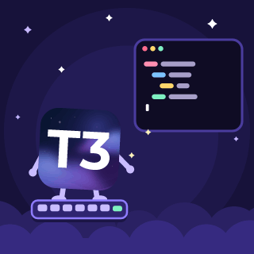

# T3Code RPC

Discord Rich Presence for [T3 Code](https://t3.codes): animated art that follows what your agents are doing, and your token usage for the last 30 days.

<p>





</p>

Every character is the real logo: the T3 Code Nightly icon, Clawd for Claude, and the Codex, Grok, Gemini, Cursor, OpenCode, Muse, Mistral, Pi and Antigravity marks. They all get little arms and legs.

## What it shows

| T3 Code is… | Art | Card |
| --- | --- | --- |
| Orchestrating subagents | The conductor floats and waves a wand while every subagent's logo circles it; the badge shows the exact count | 🪄 Orchestrating 4 agents · Claude Opus 5.5 → 3 Codex · 1 Grok |
| Running several threads | The T3 Code icon conducts all of them | 🪄 Running 3 agents at once |
| Thinking / replying | Thought bubble | 💭 Thinking · GPT-6.1 Sol |
| Editing files | Typing, code flying into an editor | ⌨️ Editing code |
| Running commands / tools | Terminal | 🖥️ Running commands |
| Reading / searching the codebase | Magnifying glass over pages | 🔍 Reading the codebase |
| Searching the web | Holding up a spinning globe | 🌐 Browsing the web |
| Waiting for approval or an answer | Hopping with a "?" sign | ✋ Waiting for approval |
| Just finished | Party hat and confetti | ✨ Task complete |
| Something failed | A little rain cloud | 🌧️ Hit a snag |
| Open but idle | Nightcap and z's | 💤 Idle |

The second line rotates between the agents and your token total (`⚡ 4.12B tokens · last 30 days`). Hovering the art or the badge shows the model, an input/output/cache breakdown and the turn count. Presence clears when T3 Code closes.

**Privacy:** chat titles and message contents never reach Discord. The daemon never reads them: it only looks at run statuses, provider/model ids, tool types, subagent counts and token numbers. The project folder name is hidden unless you turn on `showProject`.

## Install

Requires Node.js 22.18+, the Discord desktop app and T3 Code. Works with base T3 Code (stable, Nightly or the `t3` CLI server) and forks such as SSHCode. It watches `~/.t3`, `$T3CODE_HOME` and any `~/.t3-*` data folder, and follows whichever one is running.

```sh
npm install -g https://github.com/SSHdotCodes/t3code-rpc/tarball/main
t3code-rpc install    # start at login (launchd / systemd / Startup folder)
t3code-rpc doctor     # check Discord, T3 Code and art hosting
```

Other commands: `status`, `preview --watch`, `usage --days 7`, `demo orbit --as claude --with codex,codex,grok`, `logs -f`, `stop`, `start`, `uninstall`.

## Configure

`~/.t3code-rpc/config.json` (or `t3code-rpc config set <key> <value>`):

| Key | Default | |
| --- | --- | --- |
| `tokens.windowDays` | `30` | Token window in days, `0` = all time |
| `tokens.metric` | `"total"` | `total` (input incl. cache + output), `fresh` (without cache reads) or `output` |
| `tokens.show` | `true` | |
| `showModel` | `true` | Show model names (otherwise just the provider) |
| `showProject` | `false` | Append the project folder name. Chat names are never shown. |
| `showElapsed` | `true` | Elapsed timer |
| `showIdle` | `true` | Show the napping art while T3 Code is open and idle |
| `rotateSec` | `20` | How often the second line rotates |
| `doneHoldSec` / `errorHoldSec` | `90` / `60` | How long the celebration and snag art stay up |
| `statusDisplay` | `"name"` | What the member list shows: `name`, `details` or `state` |
| `activityType` | `0` | 0 Playing, 2 Listening, 3 Watching, 5 Competing |
| `buttons` | T3 Code + this repo | Up to two `{ "label", "url" }` |
| `clientId` | T3 Code app | Your own Discord application id, if you want one |
| `art.baseUrl` | this repo's `assets/art` | Where the GIF pack is hosted |
| `art.dynamic.enabled` | `false` | Render exact mixed orchestration rings on demand (see below) |

### Exact orchestration rings

The pack includes pre-rendered rings for common teams, for example Claude, Codex or the T3 icon conducting several Claude, Codex or Grok agents. For any other mix, such as "Opus conducting 3 Codex, 1 Grok and 1 Mistral", turn on dynamic rings. Each new combination is rendered once locally (needs `ffmpeg`) and pushed to an `art-cache` branch of a public repo you own, using `gh auth`. After that it's reused forever.

```sh
t3code-rpc config set art.dynamic.enabled true
t3code-rpc config set art.dynamic.githubRepo you/your-public-repo
```

## How it works

- **State:** T3 Code keeps its state in `~/.t3/userdata/statev2.sqlite`. The daemon opens it **read-only** and polls a handful of indexed queries every second (about 5 ms): active runs, live turn items, pending approvals, and subagent and delegated-child relationships. Liveness comes from the server's runtime record plus its public `/.well-known/t3/environment` probe.
- **Tokens:** summed from T3 Code's per-turn accounting (`turnTokenUsage`) over a trailing window. Input already includes cache reads and writes, so nothing is double counted.
- **Discord:** a small built-in IPC client with no dependencies. It dedupes payloads, caps writes at 4 per 20 s with a minimum gap, and reconnects with jittered backoff.
- **Art:** every frame is drawn as SVG (`src/render`), rasterized with resvg and encoded with ffmpeg using a shared palette. `npm run assets` re-renders the whole pack in about 15 s; `npm run preview` renders contact sheets.

## Credits

Inspired by [codex-rpc](https://github.com/SSHdotCodes/codex-rpc) and [claude-rpc](https://github.com/rar-file/claude-rpc). Logos belong to their owners and are used to identify each provider. Sources are listed in [`assets/src/logos`](assets/src/logos/README.md). T3 Code assets are © pingdotgg (MIT).

MIT License.
